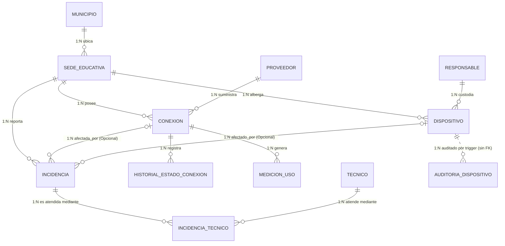

# FASE 1: REQUISITOS Y DIAGRAMA ER

## 1. Requerimientos del Sistema

* **R01:** Registrar datos de la sede educativa (municipio y zona).
* **R02:** Registrar conexiones instaladas por sede, detallando proveedor, tipo de red, velocidad y vigencia.
* **R03:** Mantener un historial de cambios de estado de las conexiones con fecha y hora.
* **R04:** Registrar el inventario de dispositivos físicos, estado de entrega y responsable.
* **R05:** Registrar incidencias y mantenimientos con fechas de apertura y cierre.
* **R06:** Almacenar mediciones periódicas de uso del servicio en horas activas.
* **R07:** Registrar los técnicos de mantenimiento y asignar uno o varios de ellos (principal y apoyo) a cada incidencia, conservando el rol y la fecha de asignación.
* **R08:** Auditar los cambios de estado físico y de responsable de los dispositivos, guardando el valor anterior, el valor nuevo, el usuario que lo hizo y la fecha del cambio.

## 2. Reglas de Negocio
* **RN01:** Una sede puede tener múltiples conexiones de forma simultánea o secuencial (Historial).
* **RN02:** El registro de estado de una conexión es incremental e inmutable (no sobrescribe estados anteriores).
* **RN03:** Todo dispositivo físico exige un responsable basado en un cargo/dependencia (protección de datos personales).
* **RN04:** El tiempo de reparación de una falla se calcula derivando la diferencia entre la fecha de cierre y apertura (no se digita manualmente).
* **RN05:** La conexión y el dispositivo reportados en una incidencia deben pertenecer a la misma sede que reporta la incidencia (no basta con que existan).
* **RN06:** Una incidencia puede ser atendida por varios técnicos y un técnico atiende muchas incidencias a lo largo del tiempo. El técnico se identifica por un código anonimizado y una especialidad, sin datos personales (protección de datos personales, como en RN03). Un técnico con atenciones registradas no se elimina: se desactiva.
* **RN07:** Todo cambio real de estado físico o de responsable de un dispositivo deja un registro de auditoría. La auditoría se conserva aunque el equipo se retire del inventario.

## 3. Catálogo Conceptual de Entidades y Glosario

| Entidad | Tipo | Descripción |
| :--- | :--- | :--- |
| *SEDE_EDUCATIVA* | Fuerte | Escuela rural u oficial. Almacena su ubicación física e identificador. |
| *PROVEEDOR* | Catálogo | Empresa de telecomunicaciones que suministra el servicio de internet. |
| *CONEXION* | Transaccional | Enlace de internet instalado en una sede bajo un contrato o vigencia. |
| *HISTORIAL_ESTADO_CONEXION* | Débil | Bitácora que registra de forma inmutable los cambios de operatividad (activo, caído, intermitente). |
| *DISPOSITIVO* | Transaccional | Equipo físico de dotación tecnológica (router, PC, antena). |
| *RESPONSABLE* | Catálogo | Dependencia o cargo institucional que custodia un dispositivo (ej. Rectoría). |
| *INCIDENCIA* | Transaccional | Reporte de falla técnica o mantenimiento operativo. |
| *MEDICION_USO* | Transaccional | Registro periódico de consumo o disponibilidad (horas de servicio activo). |
| *MUNICIPIO* | Catálogo | División administrativa donde se ubica la sede. |
| *TECNICO* | Catálogo | Responsable de mantenimiento identificado por un código anonimizado y una especialidad (Redes, Hardware, Energía, Satelital, Soporte general). |
| *INCIDENCIA_TECNICO* | Asociativa (N:M) | Resuelve la relación muchos a muchos entre incidencias y técnicos; registra el rol asignado (Principal o Apoyo) y la fecha de asignación. |
| *AUDITORIA_DISPOSITIVO* | Bitácora | Rastro de los cambios de estado físico y de responsable de un dispositivo. No tiene llave foránea a DISPOSITIVO para conservar el rastro aunque el equipo se retire. |

## 4. Diagrama ER

> **Nota:** la relación N:M entre `INCIDENCIA` y `TECNICO` se resuelve con la entidad asociativa `INCIDENCIA_TECNICO`. La línea punteada hacia `AUDITORIA_DISPOSITIVO` indica un vínculo lógico por `codigo_inventario`, sin llave foránea.