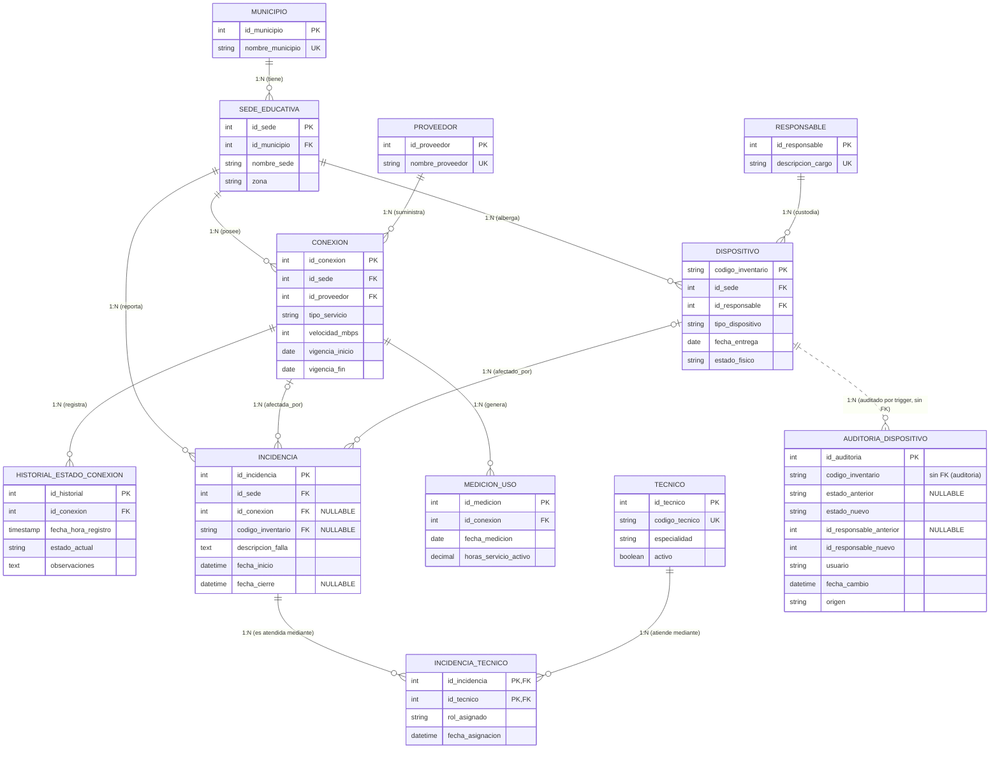

# FASE 2: MODELO LÓGICO Y NORMALIZACIÓN

## 1. Diagrama relacional

## 2. Diccionario de Datos y Modelo Lógico

A continuación se detallan las entidades del sistema con sus respectivos atributos, claves y restricciones:

*   **MUNICIPIO:** `id_municipio` (PK), `nombre_municipio` (UNIQUE, NOT NULL).
*   **SEDE_EDUCATIVA:** `id_sede` (PK), `id_municipio` (FK, NOT NULL), `nombre_sede` (NOT NULL), `zona` (Dominio: *'Rural', 'Palafito'*, NOT NULL).
*   **PROVEEDOR:** `id_proveedor` (PK), `nombre_proveedor` (UNIQUE, NOT NULL).
*   **CONEXION:** `id_conexion` (PK), `id_sede` (FK, NOT NULL), `id_proveedor` (FK, NOT NULL), `tipo_servicio` (Dominio: *'Satelital', 'Fibra', 'Radioenlace'*, NOT NULL), `velocidad_mbps` (Numérico, NOT NULL, mayor que 0), `vigencia_inicio` (Fecha, NOT NULL), `vigencia_fin` (Fecha, NULL, no anterior a `vigencia_inicio`).
*   **HISTORIAL_ESTADO_CONEXION:** `id_historial` (PK), `id_conexion` (FK, NOT NULL), `fecha_hora_registro` (Timestamp, NOT NULL, por defecto la fecha y hora actual), `estado_actual` (Dominio: *'Activo', 'Intermitente', 'Caído'*, NOT NULL), `observaciones` (Texto, NULL). Tabla inmutable (RN02): solo admite INSERT.
*   **RESPONSABLE:** `id_responsable` (PK), `descripcion_cargo` (UNIQUE, NOT NULL).
*   **DISPOSITIVO:** `codigo_inventario` (PK Alfanumérica, NOT NULL), `id_sede` (FK, NOT NULL), `id_responsable` (FK, NOT NULL), `tipo_dispositivo` (NOT NULL), `fecha_entrega` (Fecha, NOT NULL, por defecto la fecha actual), `estado_fisico` (Dominio: *'Bueno', 'Regular', 'Dañado'*, NOT NULL, por defecto *'Bueno'*).
*   **INCIDENCIA:** `id_incidencia` (PK), `id_sede` (FK, NOT NULL), `id_conexion` (FK, NULL), `codigo_inventario` (FK, NULL), `descripcion_falla` (Texto, NOT NULL), `fecha_inicio` (Fecha y hora, NOT NULL, por defecto la fecha y hora actual), `fecha_cierre` (Fecha y hora, NULL, no anterior a `fecha_inicio`). La conexión y el dispositivo indicados deben pertenecer a `id_sede` (RN05, validado con trigger). Las horas de reparación no se almacenan: se derivan de las fechas (RN04).
*   **MEDICION_USO:** `id_medicion` (PK), `id_conexion` (FK, NOT NULL), `fecha_medicion` (Fecha, NOT NULL), `horas_servicio_activo` (Decimal, NOT NULL, entre 0 y 744).
*   **TECNICO:** `id_tecnico` (PK), `codigo_tecnico` (UNIQUE, NOT NULL, código anonimizado, ej. *TEC-001*), `especialidad` (Dominio: *'Redes', 'Hardware', 'Energia', 'Satelital', 'Soporte general'*, NOT NULL), `activo` (Booleano 0/1, NOT NULL, por defecto 1). Un técnico se desactiva, no se borra.
*   **INCIDENCIA_TECNICO** (tabla puente N:M): (`id_incidencia`, `id_tecnico`) (PK compuesta, ambas FK), `rol_asignado` (Dominio: *'Principal', 'Apoyo'*, NOT NULL, por defecto *'Principal'*), `fecha_asignacion` (Fecha y hora, NOT NULL, por defecto la fecha y hora actual).
*   **AUDITORIA_DISPOSITIVO:** `id_auditoria` (PK), `codigo_inventario` (NOT NULL, sin FK), `estado_anterior` (NULL en la carga inicial), `estado_nuevo` (Dominio: *'Bueno', 'Regular', 'Dañado'*, NOT NULL), `id_responsable_anterior` (NULL), `id_responsable_nuevo` (NOT NULL), `usuario` (NOT NULL, por defecto *'sistema'*), `fecha_cambio` (Fecha y hora, NOT NULL, por defecto la fecha y hora actual), `origen` (NOT NULL, *'Trigger'* o *'Carga inicial'*).

### Acciones referenciales (ON DELETE / ON UPDATE)

| Regla | Aplicación | Justificación |
| :--- | :--- | :--- |
| `ON UPDATE CASCADE` | Todas las llaves foráneas | Si cambia una llave padre, el cambio se propaga y no quedan referencias huérfanas. |
| `ON DELETE RESTRICT` | Catálogos y tablas transaccionales; `INCIDENCIA_TECNICO` → `TECNICO` | Protege el historial: no se borra un municipio con sedes, una sede con conexiones o incidencias, una conexión con historial o mediciones (RN01, RN02), ni un técnico con atenciones. |
| `ON DELETE CASCADE` | Solo `INCIDENCIA_TECNICO` → `INCIDENCIA` | La asignación es una fila dependiente que no tiene significado sin su incidencia. |

---

## 3. Decisiones de Normalización (Dependencias Funcionales)

El modelo de base de datos ha sido diseñado para cumplir con la **Tercera Forma Normal (3FN)**, garantizando la integridad de los datos y evitando redundancias:

*   **1FN (Valores atómicos y sin grupos repetidos):** Se extrajo el historial de conexiones hacia una tabla hija transaccional (`HISTORIAL_ESTADO_CONEXION`) en lugar de almacenar múltiples columnas de estados o fechas de conexión en la tabla principal de la sede. Del mismo modo, los técnicos que atienden una incidencia no se guardan como una lista o columnas repetidas (`tecnico_1`, `tecnico_2`) dentro de `INCIDENCIA`, sino como filas en la tabla puente `INCIDENCIA_TECNICO`.
*   **2FN (Dependencias parciales):** Todos los atributos dependen de la clave primaria completa. Se utilizaron claves simples artificiales (como `id_sede`, `id_conexion`, `id_tecnico`) y claves naturales (como `codigo_inventario`). En la tabla puente, que tiene clave compuesta (`id_incidencia`, `id_tecnico`), los atributos `rol_asignado` y `fecha_asignacion` describen la asignación de ese técnico a esa incidencia, es decir, dependen de la clave completa y no de una de sus partes.
*   **3FN (Dependencias transitivas eliminadas):** Se aislaron `MUNICIPIO`, `PROVEEDOR`, `RESPONSABLE` y `TECNICO` en catálogos (tablas) independientes. 
    *   *Justificación de anomalías:* Aislar el municipio evita la **anomalía de inserción** (permite crear un municipio en el sistema sin necesidad de tener escuelas registradas aún). Por otro lado, aislar el proveedor evita la **anomalía de actualización** (si un proveedor cambia de razón social, la modificación se realiza en un solo registro y no se tiene que actualizar en cientos de conexiones individuales). Aislar al técnico evita la **anomalía de borrado**: al ser una entidad propia, la información del técnico no se pierde cuando se elimina una asignación o una incidencia.
*   **Relación N:M resuelta:** `INCIDENCIA` y `TECNICO` se relacionan con cardinalidad muchos a muchos (una incidencia tiene técnico principal y de apoyo; un técnico atiende muchas incidencias). Se resuelve con la tabla puente `INCIDENCIA_TECNICO`, cuya PK compuesta impide asignar dos veces el mismo técnico a la misma incidencia.
*   **Datos derivados no almacenados (RN04):** el tiempo de reparación no es una columna, porque dependería de `fecha_inicio` y `fecha_cierre` y no de la clave (dependencia transitiva). Se calcula con la función `fn_horas_reparacion`.
*   **Tabla de auditoría (decisión de diseño):** `AUDITORIA_DISPOSITIVO` guarda deliberadamente una copia de los valores anteriores y nuevos de un dispositivo, sin llave foránea. Es una bitácora histórica (una fotografía de cada cambio), no una redundancia que deba normalizarse: debe conservarse aunque el equipo se retire del inventario.
*   **Integridad que la normalización no cubre (RN05):** la 3FN y las llaves foráneas solo garantizan que la conexión y el dispositivo de una incidencia existan, no que pertenezcan a la sede que la reporta. Esa coherencia entre tablas se hace cumplir con el trigger `trg_incidencia_validar_coherencia`, y la inmutabilidad del historial (RN02) con los triggers `trg_historial_no_update` y `trg_historial_no_delete`.
