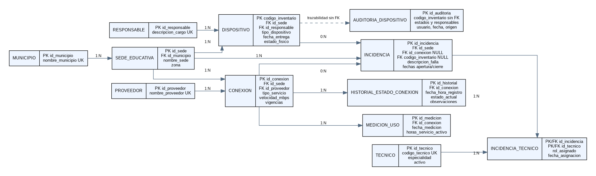

\newpage

# Resumen ejecutivo

Esta memoria documenta el diseño, implementación, pruebas y optimización del
sistema de gestión de datos para escuelas rurales. La solución administra
municipios, sedes, conexiones, historial operativo, dispositivos,
responsables, mediciones, incidencias, técnicos y auditorías.

El modelo contiene 12 tablas relacionales y está diseñado para cumplir al menos
la tercera forma normal (3FN). Está implementado para MariaDB 10.4 o superior,
utiliza InnoDB e integridad referencial estricta, y fue validado mediante una
instalación limpia, carga de al menos 50 registros por tabla, pruebas
automatizadas, análisis de planes de ejecución y prueba de concurrencia.

**Repositorio del proyecto:** https://github.com/MatiasGreg/Base-de-datos-Escuelas-Rurales

\tableofcontents
\newpage

# Introducción y contexto

## 1. Descripción del problema

Las instituciones educativas rurales requieren controlar la disponibilidad de
los servicios de conectividad y el estado de su dotación tecnológica. Los
datos deben permitir conocer qué sede tiene problemas, qué proveedor o
conexión está involucrada, qué equipo fue afectado, quién atiende cada
incidencia y qué cambios fueron realizados sobre el inventario.

El problema requiere conservar historiales de estado, evitar inconsistencias
entre incidencias y recursos de una sede, calcular tiempos de reparación,
asignar varios técnicos a una incidencia y preservar auditorías aunque un
dispositivo sea retirado del inventario.

## 2. Objetivos

### Objetivo general

Diseñar e implementar una base de datos relacional completa que centralice y
proteja la información operativa de conectividad y mantenimiento tecnológico
en escuelas rurales.

### Objetivos específicos

- Identificar requerimientos funcionales y reglas de negocio.
- Construir el diagrama Entidad-Relación y el modelo relacional.
- Aplicar las tres primeras formas normales.
- Implementar tablas, restricciones, índices y datos de prueba.
- Desarrollar vistas, funciones, procedimientos y triggers.
- Ejecutar pruebas de integridad, transacciones y concurrencia.
- Analizar consultas mediante planes de ejecución y justificar los índices.

## 3. Alcance

El alcance incluye el ciclo completo de diseño y almacenamiento. No incluye
una interfaz gráfica de usuario ni autenticación de aplicación; estas funciones
quedan identificadas como trabajo futuro.

# Fase 1: especificación y modelo conceptual

## 1. Requerimientos funcionales

| ID | Requerimiento |
|---|---|
| R01 | Registrar municipio y zona de cada sede educativa. |
| R02 | Registrar conexiones instaladas por sede, proveedor, tipo, velocidad y vigencia. |
| R03 | Mantener el historial de estados de las conexiones con fecha y hora. |
| R04 | Registrar inventario, responsable y estado físico de dispositivos. |
| R05 | Registrar incidencias y mantenimientos con apertura y cierre. |
| R06 | Almacenar mediciones periódicas de horas de servicio activo. |
| R07 | Asignar uno o varios técnicos principales o de apoyo a cada incidencia. |
| R08 | Auditar cambios reales de estado físico y responsable. |

## 2. Reglas de negocio

| ID | Política |
|---|---|
| RN01 | Una sede puede tener múltiples conexiones simultáneas o secuenciales. |
| RN02 | El historial de conexión es incremental e inmutable. |
| RN03 | Todo dispositivo tiene un responsable basado en cargo o dependencia. |
| RN04 | El tiempo de reparación se calcula, no se digita ni almacena. |
| RN05 | Conexión y dispositivo de una incidencia deben pertenecer a su sede. |
| RN06 | Técnicos identificados por código; atenciones requieren desactivación, no borrado. |
| RN07 | Cada cambio real de estado físico o responsable deja auditoría histórica. |

## 3. Catálogo de entidades

| Entidad | Tipo | Función |
|---|---|---|
| MUNICIPIO | Catálogo | Identifica la división administrativa. |
| SEDE_EDUCATIVA | Fuerte | Representa una escuela rural o sede. |
| PROVEEDOR | Catálogo | Identifica el servicio de telecomunicaciones. |
| CONEXION | Transaccional | Representa un enlace y su vigencia. |
| HISTORIAL_ESTADO_CONEXION | Débil/histórico | Conserva cambios de estado. |
| RESPONSABLE | Catálogo | Describe cargos o dependencias custodias. |
| DISPOSITIVO | Transaccional | Registra equipos tecnológicos. |
| INCIDENCIA | Transaccional | Registra fallas y mantenimientos. |
| MEDICION_USO | Transaccional | Conserva disponibilidad mensual. |
| TECNICO | Catálogo | Identifica personal por código anonimizado y especialidad. |
| INCIDENCIA_TECNICO | Asociativa N:M | Define técnico principal o de apoyo por incidencia. |
| AUDITORIA_DISPOSITIVO | Bitácora | Conserva cambios históricos sin FK al dispositivo. |

## 4. Diagrama Entidad-Relación



La relación muchos a muchos entre `INCIDENCIA` y `TECNICO` se resuelve mediante
`INCIDENCIA_TECNICO`. `AUDITORIA_DISPOSITIVO` conserva el valor
`codigo_inventario` como referencia histórica, sin llave foránea, para proteger
la evidencia aunque el equipo sea retirado del inventario.

# Fase 2: modelo lógico y normalización

## 1. Modelo relacional

Las claves primarias y foráneas quedan distribuidas de la siguiente manera:

| Tabla | Clave primaria | Claves foráneas |
|---|---|---|
| MUNICIPIO | id_municipio | — |
| PROVEEDOR | id_proveedor | — |
| RESPONSABLE | id_responsable | — |
| TECNICO | id_tecnico | — |
| SEDE_EDUCATIVA | id_sede | id_municipio |
| CONEXION | id_conexion | id_sede, id_proveedor |
| HISTORIAL_ESTADO_CONEXION | id_historial | id_conexion |
| DISPOSITIVO | codigo_inventario | id_sede, id_responsable |
| INCIDENCIA | id_incidencia | id_sede, id_conexion, codigo_inventario |
| MEDICION_USO | id_medicion | id_conexion |
| INCIDENCIA_TECNICO | id_incidencia, id_tecnico | ambas |
| AUDITORIA_DISPOSITIVO | id_auditoria | ninguna |

## 2. Primera forma normal

Se utilizaron columnas individuales, valores atómicos y no se almacenaron
listas repetidas. Los estados de conexión se separaron a
`HISTORIAL_ESTADO_CONEXION`. Los técnicos asignados se representan con filas
de `INCIDENCIA_TECNICO`, no con columnas `tecnico_1` y `tecnico_2`.

## 3. Segunda forma normal

Las relaciones con claves simples tienen atributos que dependen completamente
de su clave primaria. En `INCIDENCIA_TECNICO`, la clave compuesta
(`id_incidencia`, `id_tecnico`) determina `rol_asignado` y
`fecha_asignacion`.

## 4. Tercera forma normal

Los nombres de municipios, proveedores, responsables y técnicos no se repiten
dentro de las relaciones transaccionales. Cada dato depende de la llave primaria
sin pasar por una columna no clave:

- `SEDE_EDUCATIVA.id_municipio` reemplaza el nombre del municipio.
- `CONEXION.id_proveedor` reemplaza el nombre del proveedor.
- `DISPOSITIVO.id_responsable` reemplaza la descripción del cargo.
- `INCIDENCIA_TECNICO` separa asignación, incidencia y técnico.
- Las horas de reparación y disponibilidad son derivadas, no columnas.

## 5. Matriz de dependencias funcionales

| Relación | Determinante | Atributos determinados |
|---|---|---|
| MUNICIPIO | id_municipio | nombre_municipio |
| PROVEEDOR | id_proveedor | nombre_proveedor |
| RESPONSABLE | id_responsable | descripcion_cargo |
| TECNICO | id_tecnico | codigo_tecnico, especialidad, activo |
| SEDE_EDUCATIVA | id_sede | id_municipio, nombre_sede, zona |
| CONEXION | id_conexion | id_sede, id_proveedor, tipo, velocidad, vigencias |
| HISTORIAL_ESTADO_CONEXION | id_historial | id_conexion, fecha, estado, observaciones |
| DISPOSITIVO | codigo_inventario | sede, responsable, tipo, fecha, estado |
| INCIDENCIA | id_incidencia | sede, conexión, dispositivo, falla y fechas |
| MEDICION_USO | id_medicion | conexión, fecha y horas activas |
| INCIDENCIA_TECNICO | id_incidencia, id_tecnico | rol y fecha |
| AUDITORIA_DISPOSITIVO | id_auditoria | valores y metadatos del cambio |

Las dependencias completas y las justificaciones adicionales se encuentran en
`docs/dependencias_funcionales.md`.

## 6. Acciones referenciales

| Acciones | Aplicación | Justificación |
|---|---|---|
| ON UPDATE CASCADE | Todas las FK de relaciones operativas | Propaga cambios de llaves padres. |
| ON DELETE RESTRICT | Relaciones con catálogos e historial | Impide borrar entidades que tienen dependencias. |
| ON DELETE CASCADE | INCIDENCIA_TECNICO → INCIDENCIA | Elimina solo la asignación dependiente. |

## 7. Coherencia no cubierta por 3FN

Las llaves foráneas garantizan existencia, pero no garantizan que una conexión
o dispositivo pertenezca a la sede declarada en una incidencia. Los triggers
insert/update resuelven RN05 mediante validaciones cruzadas.

# Fase 3: implementación física

## 1. Motor y creación

El modelo utiliza:

- Base de datos: `bd_escuelas_rurales`.
- Motor: InnoDB.
- Codificación: `utf8mb4`.
- Intercalación: `utf8mb4_unicode_ci`.
- PK autoincrementales o código de inventario natural.

## 2. Restricciones

Se aplicaron:

- PK y FK en las relaciones.
- `UNIQUE` para nombres únicos y códigos anonimizados.
- `NOT NULL` en datos esenciales.
- `DEFAULT` en estados, fechas y usuarios.
- `CHECK` para zonas, tipos de servicio, velocidades, fechas, estados,
  mediciones, especialidades y roles.
- `ON DELETE` y `ON UPDATE` contextualizados.

El `CHECK` de `CONEXION` permite `Satelital`, `Fibra`, `Radioenlace` y
`Movil`; exige velocidad positiva y vigencia final no anterior al inicio.

## 3. Diccionario de datos

La especificación completa de tipos, nulabilidad, claves y reglas está en
`docs/diccionario_datos.md`. A continuación se resumen las tablas principales:

| Tabla | Columna clave | Tipo principal | Restricción destacada |
|---|---|---|---|
| MUNICIPIO | id_municipio | INT | PK, nombre único |
| SEDE_EDUCATIVA | id_sede | INT | FK municipio, zona CHECK |
| CONEXION | id_conexion | INT | velocidad positiva y fechas coherentes |
| HISTORIAL_ESTADO_CONEXION | id_historial | INT | estado CHECK e inmutabilidad |
| DISPOSITIVO | codigo_inventario | VARCHAR(50) | estado y responsable |
| INCIDENCIA | id_incidencia | INT | sede obligatoria, recursos opcionales |
| MEDICION_USO | id_medicion | INT | horas entre 0 y 744 |
| INCIDENCIA_TECNICO | PK compuesta | INT/INT | rol CHECK |
| AUDITORIA_DISPOSITIVO | id_auditoria | INT | sin FK para conservar historial |

## 4. Carga de datos

`sql/insercion_catalogos.sql` genera 50 registros para:

- MUNICIPIO
- PROVEEDOR
- RESPONSABLE
- TECNICO
- SEDE_EDUCATIVA
- CONEXION
- HISTORIAL_ESTADO_CONEXION
- DISPOSITIVO
- MEDICION_USO
- AUDITORIA_DISPOSITIVO

La carga base crea 50 incidencias y asignaciones N:M. El script
`carga_asignaciones_tecnicos.sql` añade 10 incidencias adicionales y sus
asignaciones, obteniendo 60 incidencias y 60 asignaciones.

# Fase 4: lógica avanzada y optimización

## 1. Vistas

Se implementaron cuatro vistas:

1. `vw_resumen_general_sedes`: indicadores por sede.
2. `vw_tendencia_mensual_conectividad`: tendencias de mediciones.
3. `vw_analisis_dimension_geografica_proveedor`: análisis territorial.
4. `vw_sedes_con_alta_carga_incidencias`: sedes con al menos dos incidencias y
   al menos una abierta. Esta consulta usa `GROUP BY` y `HAVING`.

Ejemplo con HAVING:

```sql
SELECT s.id_sede, s.nombre_sede,
       COUNT(i.id_incidencia) AS total_incidencias,
       SUM(CASE WHEN i.fecha_cierre IS NULL THEN 1 ELSE 0 END)
FROM SEDE_EDUCATIVA s
JOIN INCIDENCIA i ON i.id_sede = s.id_sede
GROUP BY s.id_sede, s.nombre_sede
HAVING COUNT(i.id_incidencia) >= 2
   AND SUM(CASE WHEN i.fecha_cierre IS NULL THEN 1 ELSE 0 END) >= 1;
```

## 2. Funciones

- `fn_horas_reparacion(p_id_incidencia)`: diferencia entre apertura y cierre.
- `fn_disponibilidad_pct(p_id_conexion, p_anio, p_mes)`: porcentaje de
  disponibilidad mensual a partir de mediciones y días del mes.

## 3. Procedimientos

- `sp_registrar_incidencia`: valida datos, registra la incidencia, asigna técnico
  e inserta el estado inicial dentro de una transacción.
- `sp_cerrar_incidencia`: bloquea el registro, valida fecha y estado, registra
  cierre e historial, y calcula las horas.
- `sp_actualizar_dispositivo`: valida existencia y cambios, actualiza el equipo
  y permite que los triggers generen auditoría.

Los procedimientos usan `START TRANSACTION`, `COMMIT`, `ROLLBACK` y handlers
`SQLEXCEPTION` para evitar cambios parciales.

## 4. Triggers

Se implementaron seis triggers:

1. Bloqueo de UPDATE en el historial.
2. Bloqueo de DELETE en el historial.
3. Coherencia de incidencia al insertar.
4. Coherencia de incidencia al actualizar.
5. Auditoría al insertar un dispositivo.
6. Auditoría al cambiar estado físico o responsable.

## 5. Consultas analíticas avanzadas

```sql
SELECT * FROM vw_resumen_general_sedes
ORDER BY total_incidencias_historicas DESC;

SELECT * FROM vw_tendencia_mensual_conectividad
ORDER BY fecha_mes;

SELECT * FROM vw_analisis_dimension_geografica_proveedor
ORDER BY municipio;

SELECT * FROM vw_sedes_con_alta_carga_incidencias
ORDER BY total_incidencias DESC;
```

## 6. Índices y EXPLAIN

El script `explain_optimizacion.sql` analiza:

- Incidencias por rango de fecha de inicio.
- Incidencias abiertas por fecha de cierre.
- Último estado de una conexión por fecha y ID.

Los índices analíticos son:

- `idx_incidencia_fecha_inicio(fecha_inicio)`.
- `idx_incidencia_fecha_cierre(fecha_cierre)`.
- `idx_historial_conexion_fecha(id_conexion, fecha_hora_registro)`.

En la prueba de MariaDB 10.4.34, el análisis por incidencia abierta utilizó
`idx_incidencia_fecha_cierre`; la consulta del último estado utilizó
`idx_historial_conexion_fecha`.

## 7. Estrés concurrente

Los scripts `estres_concurrencia_sesion_1.sql` y
`estres_concurrencia_sesion_2.sql` ejecutan dos sesiones:

1. La sesión 1 obtiene el bloqueo de fila con `SELECT ... FOR UPDATE`.
2. Cambia el estado y mantiene el bloqueo durante cinco segundos.
3. La sesión 2 intenta el mismo cambio y espera.
4. La sesión 1 confirma con `COMMIT`.
5. La sesión 2 continúa y confirma.
6. Los triggers registran ambos cambios en auditoría.

# Fase 5: pruebas y evidencia

## 1. Entorno de validación

Se realizó una instalación limpia en Docker con MariaDB 10.4.34 e InnoDB.
Las instrucciones de instalación pueden repetirse desde:

```bash
mysql -u root -p < sql/script_creacion_tablas.sql
mysql -u root -p < sql/insercion_catalogos.sql
mysql -u root -p < sql/carga_asignaciones_tecnicos.sql
mysql -u root -p < sql/logica_avanzada.sql
mysql -u root -p < sql/vistas.sql
```

## 2. Resultado de carga

| Tabla | Filas verificadas |
|---|---:|
| MUNICIPIO | 50 |
| PROVEEDOR | 50 |
| RESPONSABLE | 50 |
| TECNICO | 50 |
| SEDE_EDUCATIVA | 50 |
| CONEXION | 50 |
| HISTORIAL_ESTADO_CONEXION | 50 |
| DISPOSITIVO | 50 |
| MEDICION_USO | 50 |
| AUDITORIA_DISPOSITIVO | 50 |
| INCIDENCIA | 60 |
| INCIDENCIA_TECNICO | 60 |

## 3. Pruebas de restricciones

Las pruebas intencionalmente incorrectas confirmaron el rechazo de:

- Zona `Urbana` mediante `chk_sede_zona`.
- Tipo `Cable` y velocidad cero mediante restricciones de conexión.
- 800 horas mensuales mediante `chk_medicion_horas`.

## 4. Pruebas de objetos programables

Las pruebas verificaron:

- Cálculo de horas de reparación.
- Cálculo de disponibilidad.
- Registro y cierre transaccional de una incidencia.
- Imposibilidad de modificar o borrar el historial.
- Coherencia entre sede, conexión y dispositivo.
- Generación de auditoría al modificar dispositivos.

## 5. Prueba concurrente

La sesión 2 esperó el bloqueo, confirmó su actualización y dejó el dispositivo
en estado `Dañado`. La sesión 1 confirmó primero el estado `Regular`. La
prueba mostró serialización InnoDB y auditoría posterior.

# Conclusiones

El proyecto cumple el ciclo completo: requisitos, diagrama conceptual, modelo
relacional, normalización hasta 3FN, implementación física, carga masiva,
restricciones, objetos programables, vistas, pruebas y optimización.

El diseño evita redundancias mediante catálogos y relaciones; protege
historiales mediante triggers; garantiza coherencia cruzada que las FK no
pueden expresar por sí solas; y conserva auditorías aun si un equipo se retira
del inventario.

El uso de InnoDB, transacciones, bloqueos de fila y claves foráneas proporciona
integridad bajo operaciones normales y concurrentes.

# Trabajo futuro

- Incorporar autenticación, perfiles y permisos de aplicación.
- Crear una interfaz web o móvil para registro y seguimiento.
- Automatizar el cierre de alertas y disponibilidad crítica.
- Incorporar particionado del historial y mediciones por fecha.
- Agregar copias de seguridad y plan de recuperación.
- Crear tablero geográfico de proveedores y sedes.
- Aumentar la automatización de pruebas y publicar resultados por versión.

# Referencias de entrega

- Repositorio: https://github.com/MatiasGreg/Base-de-datos-Escuelas-Rurales
- Requisitos y diagrama ER: `docs/fase_1_requisitos_y_diagrama_er.md`
- Modelo lógico y normalización: `docs/fase_2_modelo_logico_y_normalizacion.md`
- Diccionario completo: `docs/diccionario_datos.md`
- Dependencias funcionales: `docs/dependencias_funcionales.md`
- Evidencias: `docs/evidencias_pruebas.md`
- Scripts: `sql/`
